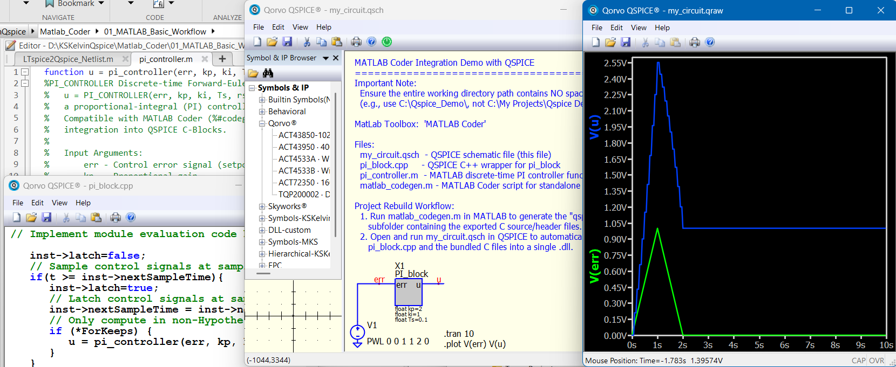

# MATLAB Coder + QSPICE C-Block Integration Demo

A minimal reference workflow demonstrating how to generate ANSI C code from a stateful MATLAB function using **MATLAB Coder** and compile it directly into a **QSPICE** C-Block DLL.

## Prerequisites

- **MATLAB** with the **MATLAB Coder** toolbox
- **QSPICE** (includes the Digital Mars C++ Compiler, `dmc`)
- **Path Requirement:** Place the project in a directory path with **no spaces** (for example, `C:\Qspice_Demo\`, not `C:\My Projects\Qspice Demo\`).

## Repository Files

| File / Folder | Role |
| :--- | :--- |
| `pi_controller.m` | Discrete-time Forward-Euler PI controller (`%#codegen`) with `persistent integ_state` and synchronous reset (`rst > 0.5`). |
| `matlab_codegen.m` | MATLAB Coder build script that generates C89/C90 source files, bundles them into `qspice_bundle/`, and cleans up temporary build folders. |
| `pi_block.cpp` | QSPICE C-Block wrapper that includes `qspice_bundle/` under `extern "C"` and handles zero-order hold sampling, `*ForKeeps` gating, and `Trunc()` timestep control. |
| `my_circuit.qsch` | QSPICE testbench schematic driving `PI_block` (`X1`) |
| `qspice_bundle/` | *(Generated)* Flat folder containing the exported C source and header files (`pi_controller.c/.h`, `pi_controller_data.c/.h`, `pi_controller_initialize.c/.h`, `pi_controller_terminate.c/.h`, and supporting headers). |

## Workflow

1. **Generate C Code in MATLAB**
   Open MATLAB in the project directory (ensuring no spaces in the path) and run:
   ```matlab
   matlab_codegen
   ```
   This script configures `coder.config('lib')` with `GenCodeOnly = true`, `TargetLang = 'C'`, and `TargetLangStandard = 'C89/C90 (ANSI)'`, runs `codegen` for `pi_controller` with scalar `double` inputs, packages all dependencies via `packNGo` (`packType = 'flat'`), extracts them into `qspice_bundle/`, and removes `qspice_bundle.zip` and `codegen/`.

2. **Compile and Simulate in QSPICE**
   Open `my_circuit.qsch` in QSPICE and run the simulation. QSPICE automatically compiles `pi_block.cpp` and the bundled C files into a single `.dll` using Digital Mars.

## How the Integration Works

- **C89/C90 Compatibility & Single-Pass Compilation:** `matlab_codegen.m` targets plain C89/C90 to avoid C++ name-mangling and match Digital Mars. In `pi_block.cpp`, `#pragma includepath "qspice_bundle"` and an `extern "C" { ... }` block include both the `.h` headers and `.c` implementation files directly so QSPICE builds the DLL in one step without an external makefile or `.lib`.
- **Discrete Sampling & `*ForKeeps` Gating:** `pi_controller.m` maintains a `persistent integ_state` variable (`integ_state = integ_state + ki * Ts * err`). To prevent QSPICE's Newton-Raphson iterations from advancing the integrator multiple times per timestep, `pi_block.cpp` schedules sample instants via `nextSampleTime` (zero-order hold) and gates calls to `pi_controller(err, kp, ki, Ts, 0)` with `if (*ForKeeps)` so state updates occur only on accepted solver steps.
- **Sample-Edge Timestep Refinement (`Trunc`):** The `sPI_BLOCK` struct tracks a `latch` flag that toggles when `t >= inst->nextSampleTime`. `Trunc()` compares `tmp.latch != inst->latch` and clamps `*timestep` to `ttol = 1e-9` (1 ns) so the solver lands accurately on each discrete sample edge.

## Screen Capture

