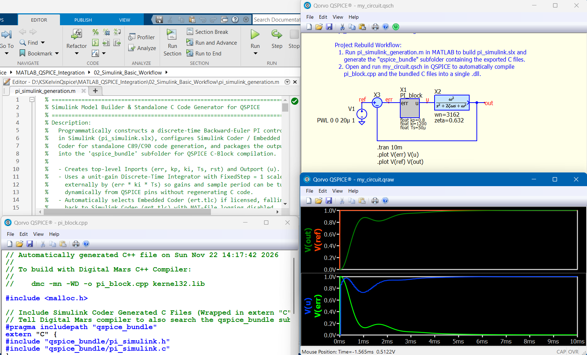

# Simulink Coder + QSPICE C-Block Integration Demo

A minimal reference workflow demonstrating how to programmatically build a discrete-time PI controller in **Simulink**, generate standalone ANSI C89/C90 code using **Embedded Coder** / **Simulink Coder**, and compile it directly into a **QSPICE** C-Block DLL.

## Prerequisites

- **MATLAB** with **Simulink** and **Simulink Coder** (automatically uses **Embedded Coder** `ert.tlc` if licensed, or falls back to `grt.tlc`)
- **QSPICE** (includes the Digital Mars C++ Compiler, `dmc`)
- **Path Requirement:** Place the project in a directory path with **no spaces** (for example, `C:\Qspice_Demo\`, not `C:\My Projects\Qspice Demo\`).

## Repository Files

| File / Folder | Role |
| :--- | :--- |
| `pi_simulink_generation.m` | MATLAB script that builds `pi_simulink.slx`, configures fixed-step discrete C89/C90 code generation, packages the C bundle into `qspice_bundle/`, and cleans up temporary build folders. |
| `pi_block.cpp` | QSPICE C-Block wrapper that includes `qspice_bundle/` under `extern "C"`, maps QSPICE pins/parameters to `pi_simulink_U`/`pi_simulink_Y`, and handles zero-order hold sampling, `*ForKeeps` gating, and `Trunc()` timestep control. |
| `my_circuit.qsch` | QSPICE testbench schematic driving `PI_block` (`X1`). |
| `pi_simulink.slx` | *(Generated)* Auto-generated Simulink discrete PI controller model. |
| `qspice_bundle/` | *(Generated)* Flat folder containing the exported C source and header files (`pi_simulink.c`, `pi_simulink.h`, and supporting headers). |

## Workflow

1. **Build the Simulink Model & Generate C Code in MATLAB**
   Open MATLAB in the project directory (ensuring no spaces in the path) and run:
   ```matlab
   pi_simulink_generation
   ```
   This script constructs `pi_simulink.slx`, configures the `FixedStepDiscrete` solver (`FixedStep = 0.1`), disables MAT-file logging and HTML report generation, generates standalone C89/C90 code via `slbuild`, packages all dependencies with `packNGo` (`packType = 'flat'`), extracts them into `qspice_bundle/`, and removes `qspice_bundle.zip`, `*_rtw/`, `slprj/`, and `pi_simulink.slxc`.

2. **Compile and Simulate in QSPICE**
   Open `my_circuit.qsch` in QSPICE and run the simulation. QSPICE automatically compiles `pi_block.cpp` and the bundled C files into a single `.dll` using Digital Mars.

## How the Integration Works

- **Simulink Model Architecture (`pi_simulink.slx`):** The script creates top-level Inports (`err`, `kp`, `ki`, `Ts`, `rst`) and Outport (`u`). The proportional path computes `kp * err`, while the integral path feeds `ki * err` into a unit-gain (`gainval = 1.0`) `Discrete-Time Integrator` set to `Integration: Backward Euler` with external `level` reset (`rst`) and inherited sample time (`-1`). Backward Euler updates the state on the current step before output, matching `integ_state = integ_state + ki*Ts*err; u = kp*err + integ_state`.
- **Sample Period Alignment (`FixedStep` vs. `Ts`):** Inside `pi_simulink.slx`, the `Ts` Inport is terminated (`Term_Ts`) because Simulink's discrete integrator uses the model's `FixedStep` (`0.1` s) for integration scaling, while `pi_block.cpp` uses the QSPICE `Ts` parameter (`0.1` s) to schedule `nextSampleTime`. Keep `FixedStep` in `pi_simulink_generation.m` aligned with `Ts` in QSPICE if you change the sample rate.
- **C89/C90 Compatibility & Single-Pass Compilation:** `pi_simulink_generation.m` sets `TargetLang = 'C'`, `TargetLangStandard = 'C89/C90 (ANSI)'`, `GenCodeOnly = 'on'`, and `MatFileLogging = 'off'` (eliminating `rt_logging.c` file I/O dependencies). In `pi_block.cpp`, `#pragma includepath "qspice_bundle"` and an `extern "C" { ... }` block include both `pi_simulink.h` and `pi_simulink.c` directly so Digital Mars builds the DLL in one step.
- **Simulink I/O Mapping & `*ForKeeps` Gating:** When `t >= inst->nextSampleTime` and `*ForKeeps` is true, `pi_block.cpp` writes `err`, `kp`, `ki`, `Ts`, and `rst = 0.0` to `pi_simulink_U`, executes `pi_simulink_step()`, and latches `u = pi_simulink_Y.u` (zero-order hold). Gating with `*ForKeeps` prevents QSPICE's hypothetical Newton-Raphson iterations from advancing the integrator state prematurely.
- **Sample-Edge Timestep Refinement (`Trunc`):** The `sPI_BLOCK` struct tracks a `latch` flag that toggles when `t >= inst->nextSampleTime`. `Trunc()` compares `tmp.latch != inst->latch` and clamps `*timestep` to `ttol = 1e-9` (1 ns) so the solver lands accurately on each discrete sample edge.

## Screen Capture

