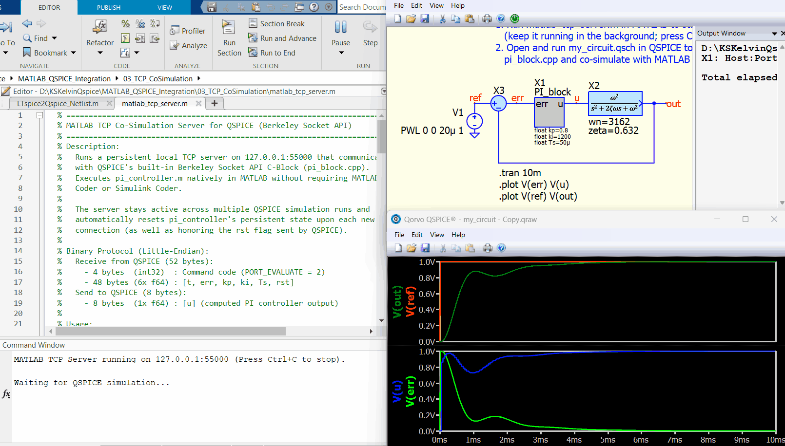

# MATLAB–QSPICE TCP Co-Simulation (Berkeley Socket API)

Real-time closed-loop co-simulation between **Qorvo QSPICE** and **MATLAB** using QSPICE's built-in **Berkeley Socket API** (`localhost:55000`). This project executes a discrete-time Proportional-Integral (PI) controller natively in MATLAB (`pi_controller.m`) without requiring **MATLAB Coder**, **Simulink Coder**, or external Winsock libraries.



---

## Important Path Requirement

> **Ensure the entire working directory path contains NO spaces.**
>
> * Good: `C:\Qspice_Demo\03_TCP_CoSimulation\`
> * Bad: `C:\My Projects\Qspice Demo\03_TCP_CoSimulation\`
>
> QSPICE's built-in Digital Mars C++ compiler (`dmc.exe`) can fail to compile C-Blocks when folder paths contain whitespace.

---

## Project Files

| File | Description |
| :--- | :--- |
| **`my_circuit.qsch`** | QSPICE closed-loop schematic containing a step reference (`V1`), error subtractor (`X3`), `PI_block` C-Block (`X1`), and a continuous-time 2nd-order Laplace plant (`X2`). |
| **`pi_block.cpp`** | QSPICE C++ client using the native Berkeley Socket API (`BerkeleySocket`, `SocketSend`, `SocketRecv`, `SocketClose`, `ConfigureBuffer`). Samples at period $T_s$ on accepted (`*ForKeeps`) timesteps and uses `Trunc()` ($t_{\text{tol}} = 1\text{ ns}$) to align solver steps with discrete sample edges. |
| **`matlab_tcp_server.m`** | Persistent MATLAB `tcpserver` listening on `127.0.0.1:55000`. Stays active across repeated QSPICE runs, resets the PI integrator state on each new run, and prints periodic status updates to the MATLAB Command Window. |
| **`pi_controller.m`** | Discrete-time Forward-Euler PI controller with a `persistent` integrator state (`integ_state`) and synchronous reset (`rst > 0.5`). |

---

## System & Benchmark Parameters

This demo simulates a closed-loop digital PI controller regulating a continuous-time 2nd-order plant over `.tran 10m`:

* **Reference Input (`V1`):** Step from $0\text{ V}$ to $1\text{ V}$ (`PWL 0 0 20u 1`)
* **Error Summer (`X3`):** $e(t) = V(\text{ref}) - V(\text{out})$
* **2nd-Order Plant (`X2`):**
  $$G(s) = \frac{\omega_n^2}{s^2 + 2\zeta\omega_n s + \omega_n^2}$$
  with $\omega_n = 3162\text{ rad/s}$ ($f_n \approx 503\text{ Hz}$), $\zeta = 0.632$, and $\text{IC} = 0$.
* **Discrete PI Controller (`X1` / `pi_controller.m`):**
  $$I[k] = I[k-1] + K_i T_s e[k], \qquad u[k] = K_p e[k] + I[k]$$
  configured on the schematic with $K_p = 0.8$, $K_i = 1200$, and $T_s = 50\ \mu\text{s}$ ($f_s = 20\text{ kHz}$).

---

## Requirements

* **MATLAB:** Base MATLAB (R2021a or later, which includes `tcpserver`). No MATLAB Coder or Simulink Coder license is required.
* **QSPICE:** Standard QSPICE installation with its built-in Digital Mars C++ compiler (`dmc`).

---

## How to Run

1. **Start the MATLAB TCP Server:**
   Open MATLAB, navigate to this project folder, and run `matlab_tcp_server.m`. Keep it running in the background once the Command Window displays:
   ```text
   MATLAB TCP Server running on 127.0.0.1:55000 (Press Ctrl+C to stop).

   Waiting for QSPICE simulation...
   ```

2. **Run the QSPICE Simulation:**
   Open `my_circuit.qsch` in QSPICE and click **Run**.
   * QSPICE automatically compiles `pi_block.cpp` into `pi_block.dll` (no extra linker flags needed; manual build command: `dmc -mn -WD -o pi_block.cpp kernel32.lib`).
   * QSPICE connects to `localhost:55000`, exchanges discrete sample packets with MATLAB over the $10\text{ ms}$ transient run, and plots `V(err)`, `V(u)`, `V(ref)`, and `V(out)`.

3. **Re-run or Stop:**
   * **Repeated Runs:** You can click **Run** in QSPICE as many times as you like without restarting MATLAB. On the very first accepted sample step of each run, `pi_block.cpp` sets `rst = 1.0` (`hasStarted == false`), and `matlab_tcp_server.m` also calls `clear pi_controller` on every new connection to ensure a clean zero-state start.
   * **Stop Server:** Press **`Ctrl+C`** in the MATLAB Command Window when finished.

---

## TCP Binary Protocol (Little-Endian)

Packets follow QSPICE's native Berkeley Socket API framing via `ConfigureBuffer()`:

* **QSPICE $\rightarrow$ MATLAB (52 bytes per sample step):**
  * `4 bytes` (`int32`): Command code (`PORT_EVALUATE = 2`)
  * `48 bytes` (`6 x double`): `[t, err, kp, ki, Ts, rst]`
* **MATLAB $\rightarrow$ QSPICE (8 bytes per sample step):**
  * `8 bytes` (`1 x double`): `[u]` (computed PI controller output)

---

## Console Logging Configuration

In `matlab_tcp_server.m`, you can control how frequently packets are printed to the MATLAB Command Window:

```matlab
verbose    = true; % Set to false to disable console printing completely
printEvery = 5;    % Print Step 1 (to verify rst = 1) and every Nth step thereafter
```

Example MATLAB console output:

```text
QSPICE connected! Co-simulation running...

 Step |    t (s) |       err |     kp |     ki |     Ts | rst |   u (out)
----------------------------------------------------------------------
    1 |   0.0000 |    0.0000 |   0.80 | 1200.00 |  0.000 |   1 |    0.0000
    5 |   0.0002 |    0.9412 |   0.80 | 1200.00 |  0.000 |   0 |    0.9274
   10 |   0.0005 |    0.7615 |   0.80 | 1200.00 |  0.000 |   0 |    1.0318
...
Simulation finished (201 steps). Ready for next run.
```

> **Tip:** For long simulations or higher sampling rates, set `verbose = false` (or increase `printEvery`) to minimize console I/O overhead.

---

## Troubleshooting

* **`Failed to connect to MATLAB server on localhost:55000`:** Make sure `matlab_tcp_server.m` is running in MATLAB *before* clicking **Run** in QSPICE.
* **Port `55000` already in use:** If a previous MATLAB server session was interrupted abnormally, run `clear server` in MATLAB (or change `port` in both `matlab_tcp_server.m` and `pi_block.cpp` and recompile `pi_block.cpp`).
* **C++ Compilation Error in QSPICE:** Verify that the full folder path contains no spaces and right-click `PI_block` $\rightarrow$ **C++ Interface** $\rightarrow$ **Compile C++** to inspect compiler output.