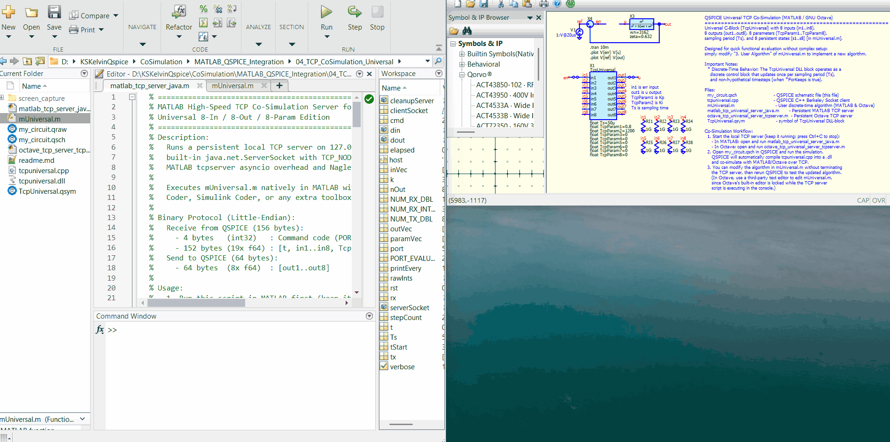

# QSPICE Universal TCP Co-Simulation (MATLAB / GNU Octave)

A plug-and-play discrete-time TCP co-simulation template between **QSPICE** and **MATLAB** or **GNU Octave**. It is designed for quick functional evaluation of custom control or signal-processing algorithms without setting up code generation or rewriting C++ interface code for every new experiment.

## Overview

The `TcpUniversal` QSPICE C-Block provides a fixed, general-purpose interface over a local TCP socket (`127.0.0.1:55000`):

- **8 Inputs:** `in1` .. `in8`
- **8 Outputs:** `out1` .. `out8`
- **8 User Parameters:** `TcpParam1` .. `TcpParam8`
- **Sampling Period:** `Ts`
- **8 Persistent States:** `s1` .. `s8` inside `mUniversal.m` (automatically reset at the start of every QSPICE run)

To test a new algorithm, you only need to edit **Section 3** of `mUniversal.m`—no C++ recompilation required.

## Repository Files

| File | Description |
| :--- | :--- |
| `my_circuit.qsch` | Demo QSPICE closed-loop schematic (2nd-order plant with a Forward-Euler PI controller on channel 1). |
| `TcpUniversal.qsym` | Reusable QSPICE symbol for the 8-in / 8-out / 8-parameter `TcpUniversal` DLL block. |
| `tcpuniversal.cpp` | QSPICE C++ Berkeley Socket client compiled automatically by QSPICE into `tcpuniversal.dll`. |
| `mUniversal.m` | Discrete-time algorithm function shared by both MATLAB and GNU Octave (`out = mUniversal(in, param, Ts, rst, t)`). |
| `matlab_tcp_server_java.m` | Persistent MATLAB TCP server using built-in `java.net.ServerSocket` with `TCP_NODELAY` (no extra toolboxes required). |
| `octave_tcp_server_tcpserver.m` | Persistent GNU Octave TCP server using `tcpserver` from the `instrument-control` package. |

## Prerequisites

- **QSPICE** (Windows)
- **MATLAB** (no extra toolboxes required) **or** **GNU Octave** with the `instrument-control` package installed (`pkg install -forge instrument-control`)
- **No spaces in the working directory path** (e.g., use `C:\Qspice_Demo\`, not `C:\My Projects\Qspice Demo\`).

## Co-Simulation Workflow

1. **Start the local TCP server** (keep it running in the background; press `Ctrl+C` in the console to stop):
   - **MATLAB:** Open and run `matlab_tcp_server_java.m`.
   - **GNU Octave:** Open and run `octave_tcp_server_tcpserver.m`.
2. **Run the QSPICE simulation:**
   - Open `my_circuit.qsch` in QSPICE and click **Run**.
   - QSPICE automatically compiles `tcpuniversal.cpp` into a `.dll` and connects to the running MATLAB/Octave server over `127.0.0.1:55000`.
3. **Iterate on your algorithm without restarting the server:**
   - Edit **Section 3** of `mUniversal.m`, save the file, and rerun the simulation in QSPICE.
   - **Octave GUI note:** Octave's built-in editor locks file saves while the TCP server loop is executing in the console. Use a third-party text editor (such as Notepad++ or VS Code) to modify and save `mUniversal.m` while the Octave server is running.

## Technical Notes

- **Discrete-Time Execution:** `TcpUniversal` behaves as a discrete control block that updates once per sampling period `Ts`. Using QSPICE's `Trunc()` hook and `*ForKeeps` flag, it only communicates with MATLAB/Octave on accepted, non-hypothetical timesteps.
- **Binary Protocol (Little-Endian, `127.0.0.1:55000`):**
  - **QSPICE → Server (156 bytes):** `int32` command (`PORT_EVALUATE = 2`) followed by 19 `double` values `[t, in1..in8, TcpParam1..TcpParam8, Ts, rst]`.
  - **Server → QSPICE (64 bytes):** 8 `double` values `[out1..out8]`.
- **Console Speed Tip:** Set `verbose = false` in `matlab_tcp_server_java.m` or `octave_tcp_server_tcpserver.m` to disable console printing for faster long runs.
