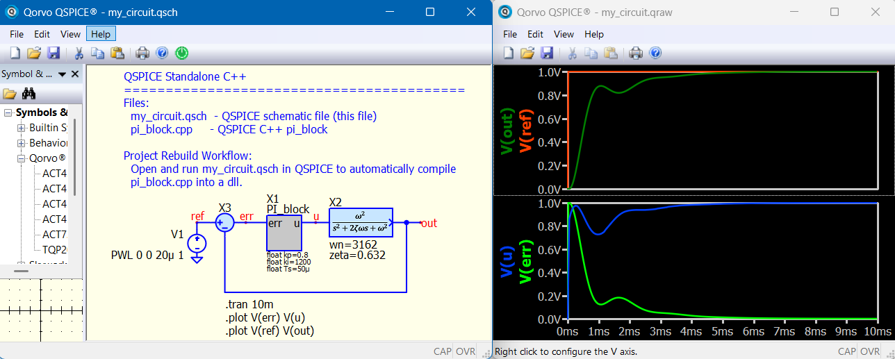

# QSPICE Standalone C++ Discrete PI Controller

A standalone **Qorvo QSPICE** closed-loop control demo implementing a discrete-time Proportional-Integral (PI) controller directly in native C++ (`pi_block.cpp`). No MATLAB, Simulink, or external libraries are required—this serves as a fast, self-contained reference baseline.

## Project Files

| File | Description |
| :--- | :--- |
| **`my_circuit.qsch`** | QSPICE closed-loop schematic with a step reference (`V1`), error subtractor (`X3`), `PI_block` C-Block (`X1`), and a continuous-time 2nd-order Laplace plant (`X2`). |
| **`pi_block.cpp`** | Standalone QSPICE C++ C-Block implementing discrete-time PI control with per-instance state (`cumsum`, `nextSampleTime`, `latch`), `*ForKeeps` gating, and `Trunc()` ($t_{\text{tol}} = 1\text{ ns}$) sample-edge alignment. |

## Closed-Loop Parameters

* **Reference (`V1`):** Step from $0\text{ V}$ to $1\text{ V}$ (`PWL 0 0 20u 1`)
* **2nd-Order Plant (`X2`):**
  $$G(s) = \frac{\omega_n^2}{s^2 + 2\zeta\omega_n s + \omega_n^2}$$
  with $\omega_n = 3162\text{ rad/s}$ ($f_n \approx 503\text{ Hz}$), $\zeta = 0.632$, and $\text{IC} = 0$.
* **Discrete PI Controller (`X1`):**
  $$I[k] = I[k-1] + K_i T_s e[k], \qquad u[k] = K_p e[k] + I[k]$$
  configured with $K_p = 0.8$, $K_i = 1200$, and $T_s = 50\ \mu\text{s}$ ($f_s = 20\text{ kHz}$).
* **Simulation:** `.tran 10m` plotting `V(err)`, `V(u)`, `V(ref)`, and `V(out)`.

## How to Run

1. Open `my_circuit.qsch` in **QSPICE**.
2. Click **Run** — QSPICE automatically compiles `pi_block.cpp` into `pi_block.dll` using its built-in Digital Mars C++ compiler and displays the transient waveforms.