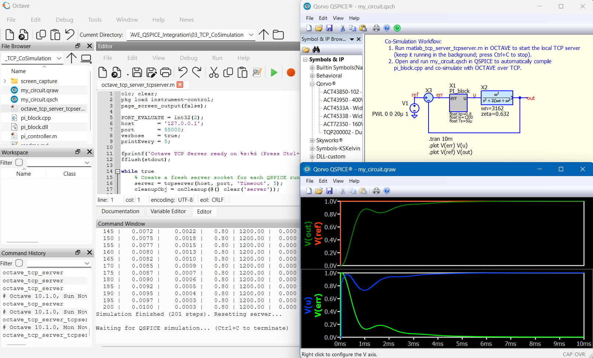

# GNU Octave–QSPICE TCP Co-Simulation (Berkeley Socket API)

Real-time closed-loop co-simulation between **Qorvo QSPICE** and **GNU Octave** using QSPICE's built-in **Berkeley Socket API** (`127.0.0.1:55000`). This project runs a discrete-time Proportional-Integral (PI) controller natively in GNU Octave (`pi_controller.m`) with zero MATLAB licensing, no C-code generation step, and no external Winsock libraries.



## Important Path Requirement

> **Ensure the entire working directory path contains NO spaces.**
>
> * Good: `C:\Qspice_Demo\Octave_TCP_CoSimulation\`
> * Bad: `C:\My Projects\Qspice Demo\Octave_TCP_CoSimulation\`
>
> QSPICE's built-in Digital Mars C++ compiler (`dmc.exe`) can fail to compile C-Blocks when folder paths contain whitespace.

## Project Files

| File | Description |
| :--- | :--- |
| **`my_circuit.qsch`** | QSPICE closed-loop schematic with a step reference (`V1`), error subtractor (`X3`), `PI_block` C-Block (`X1`), and a continuous-time 2nd-order Laplace plant (`X2`). |
| **`pi_block.cpp`** | QSPICE C++ client using the native Berkeley Socket API (`BerkeleySocket`, `SocketSend`, `SocketRecv`, `SocketClose`, `ConfigureBuffer`). Samples at period $T_s$ on accepted (`*ForKeeps`) timesteps and uses `Trunc()` ($t_{\text{tol}} = 1\text{ ns}$) to align solver steps to discrete sample edges. |
| **`octave_tcp_server_tcpserver.m`** | Persistent GNU Octave TCP server listening on `127.0.0.1:55000` via the `instrument-control` package. Uses blocking `read()` to detect QSPICE disconnect (EOF) immediately, cleanly resets the socket and PI state between runs, and releases port `55000` on `Ctrl+C`. |
| **`pi_controller.m`** | Discrete-time Forward-Euler PI controller with a `persistent` integrator state (`integ_state`) and synchronous reset (`rst > 0.5`). Fully compatible with both GNU Octave and MATLAB. |

## Closed-Loop Benchmark Parameters

This demo simulates a closed-loop digital PI controller regulating a continuous-time 2nd-order system over `.tran 10m`:

* **Reference Input (`V1`):** Step from $0\text{ V}$ to $1\text{ V}$ (`PWL 0 0 20u 1`)
* **Error Summer (`X3`):** $e(t) = V(\text{ref}) - V(\text{out})$
* **2nd-Order Plant (`X2`):**
  $$G(s) = \frac{\omega_n^2}{s^2 + 2\zeta\omega_n s + \omega_n^2}$$
  with $\omega_n = 3162\text{ rad/s}$ ($f_n \approx 503\text{ Hz}$), $\zeta = 0.632$, and $\text{IC} = 0$.
* **Discrete PI Controller (`X1` / `pi_controller.m`):**
  $$I[k] = I[k-1] + K_i T_s e[k], \qquad u[k] = K_p e[k] + I[k]$$
  configured on the schematic with $K_p = 0.8$, $K_i = 1200$, and $T_s = 50\ \mu\text{s}$ ($f_s = 20\text{ kHz}$).

## Requirements & One-Time Setup

* **QSPICE:** Standard QSPICE installation with its built-in Digital Mars C++ compiler (`dmc`).
* **GNU Octave:** Requires the **`instrument-control`** package. If not already installed, run the following once in the Octave Command Window:
  ```matlab
  pkg install -forge instrument-control
  ```
  *(The server script automatically runs `pkg load instrument-control` on startup.)*

## How to Run

1. **Start the Octave TCP Server:**
   Open GNU Octave, navigate to this project folder, and run `octave_tcp_server_tcpserver.m`. Keep it running in the background once the console displays:
   ```text
   Octave TCP Server ready on 127.0.0.1:55000 (Press Ctrl+C to stop).

   Waiting for QSPICE simulation... (Ctrl+C to terminate)
   ```

2. **Run the QSPICE Simulation:**
   Open `my_circuit.qsch` in QSPICE and click **Run**.
   * QSPICE automatically compiles `pi_block.cpp` into `pi_block.dll` (manual build command: `dmc -mn -WD -o pi_block.cpp kernel32.lib`).
   * QSPICE connects to `127.0.0.1:55000`, exchanges discrete sample packets with Octave across the $10\text{ ms}$ transient simulation, and plots `V(err)`, `V(u)`, `V(ref)`, and `V(out)`.

3. **Repeated Runs & Stopping:**
   * **Re-run freely:** When QSPICE finishes, Octave immediately detects the closed socket (EOF), prints `Simulation finished (... steps). Resetting server...`, clears `pi_controller` and recreates the listening socket, and waits for your next QSPICE run. `pi_block.cpp` also sends `rst = 1.0` on the first sample step of each run.
   * **Stop the server:** Press **`Ctrl+C`** in the Octave Command Window (`onCleanup` automatically closes and releases port `55000`).

## TCP Binary Protocol (Little-Endian)

Packets use QSPICE's native `ConfigureBuffer()` / `SocketSend()` / `SocketRecv()` framing and are decoded in Octave via `read(server, 52, 'uint8')` + `typecast`:

* **QSPICE $\rightarrow$ Octave ($52\text{ bytes}$ per sample step):**
  * $4\text{ bytes}$ (`int32`): Command code (`PORT_EVALUATE = 2`)
  * $48\text{ bytes}$ ($6 \times \text{double}$): `[t, err, kp, ki, Ts, rst]`
* **Octave $\rightarrow$ QSPICE ($8\text{ bytes}$ per sample step):**
  * $8\text{ bytes}$ ($1 \times \text{double}$): `[u]` (computed PI controller output)

## Console Logging Configuration

In `octave_tcp_server_tcpserver.m`, you can adjust console output frequency:

```matlab
verbose    = true; % Set to false to disable console printing completely
printEvery = 5;    % Print Step 1 (to verify rst = 1) and every Nth step thereafter
```

`page_screen_output(false)` and `fflush(stdout)` are enabled so status updates appear in real time without Octave's pager pausing execution.

## Troubleshooting

* **`error: tcpserver: error on bind : 10048`:** Port `55000` is still held by a previous Octave/MATLAB server instance. Run `clear all` in Octave (or stop any running MATLAB server) before restarting the script.
* **`pkg: package instrument-control is not installed`:** Run `pkg install -forge instrument-control` in Octave once, then re-run the server script.
* **`Failed to connect to ... on localhost:55000`:** Ensure `octave_tcp_server_tcpserver.m` is running and showing `Waiting for QSPICE simulation...` *before* clicking **Run** in QSPICE.
* **C++ Compilation Error in QSPICE:** Verify that the full working directory path contains no spaces and right-click `PI_block` $\rightarrow$ **C++ Interface** $\rightarrow$ **Compile C++** to inspect the compiler output.